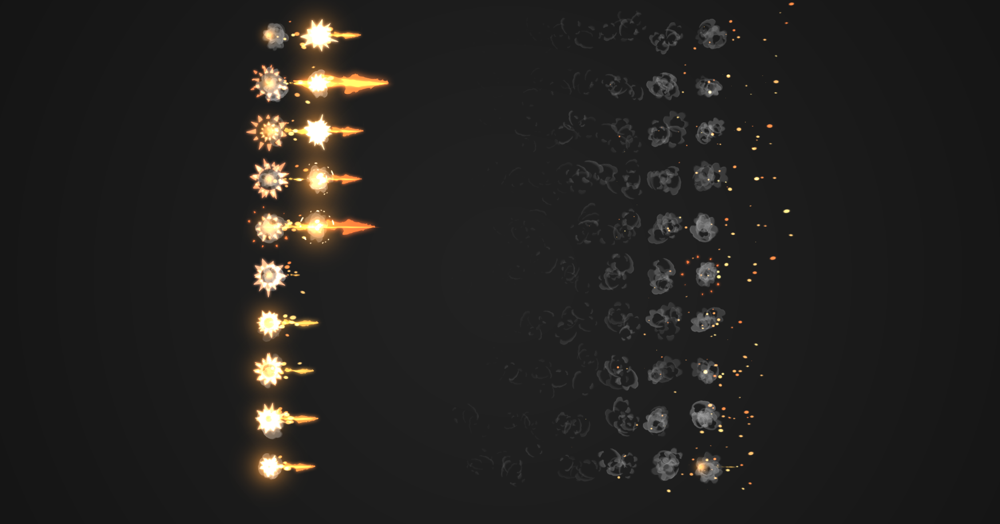

# three.quarks ✨

[![npm][npm]][npm-url]
[![npm-downloads][npm-downloads]][npmtrends-url]
[![build-size][build-size]][build-size-url]
[![github][github-star]][github-url]
[![discord][discord]][discord-url]

**three.quarks** is a high-performance particle system and visual effects library for [three.js](https://threejs.org), written in TypeScript.

Create stunning real-time VFX for games, interactive experiences, and web applications with an intuitive API and powerful visual editor.



## 🎮 Try the Demo

> **[▶️ Launch Live Demo](https://demo.quarks.art/)** - See three.quarks in action with interactive examples!

## 🔗 Quick Links

| | Resource | Description |
|--|----------|-------------|
| 📖 | [Documentation](https://quarks.art/) | Official website and guides |
| 🎨 | [Visual Editor](https://quarks.art/create) | WYSIWYG particle effect creator |
| 💬 | [Discord](https://discord.gg/5Tv3kJCrQZ) | Community support and discussion |

## 🚀 Why three.quarks?

- ⚡ **High Performance** - Optimized batch rendering minimizes draw calls
- 🖥️ **CPU or GPU Simulation** - Simulate on the CPU with any renderer, or with compute shaders on WebGPU
- 🎮 **Unity Compatible** - Import particle systems from Unity's Shuriken system
- 🎨 **Visual Editor** - Design effects visually with [three.quarks-editor](https://quarks.art/create)
- 🔧 **Flexible** - Extensible plugin system for custom behaviors and emitters
- ✅ **Production Ready** - Used in games and interactive applications

## 📦 Installation

```bash
npm install three.quarks
```

## ⚡ Quick Start

```javascript
import * as THREE from 'three';
import {
    BatchedRenderer,
    ParticleSystem,
    ConstantValue,
    IntervalValue,
    ConstantColor,
    PointEmitter,
    RenderMode
} from 'three.quarks';

// 1. Create the batch renderer (manages all particle systems)
const batchRenderer = new BatchedRenderer();
scene.add(batchRenderer);

// 2. Define your particle system
const particles = new ParticleSystem({
    duration: 2,
    looping: true,
    startLife: new IntervalValue(1, 2),
    startSpeed: new ConstantValue(5),
    startSize: new IntervalValue(0.1, 0.3),
    startColor: new ConstantColor(new THREE.Vector4(1, 1, 1, 1)),
    maxParticle: 100,
    emissionOverTime: new ConstantValue(20),
    shape: new PointEmitter(),
    material: new THREE.MeshBasicMaterial({
        map: yourTexture,
        transparent: true
    }),
    renderMode: RenderMode.BillBoard
});

// 3. Add to scene and renderer
scene.add(particles.emitter);
batchRenderer.addSystem(particles);

// 4. Update in your animation loop
function animate() {
    const delta = clock.getDelta();
    batchRenderer.update(delta);
    renderer.render(scene, camera);
    requestAnimationFrame(animate);
}
```

## 🌐 WebGPU (three.js `WebGPURenderer`)

three.quarks also renders with three.js' [`WebGPURenderer`](https://threejs.org/docs/#api/en/renderers/webgpu/WebGPURenderer).
Particle systems, behaviors, emitters and JSON effects are shared; only the batch renderer changes.
It is built on TSL node materials, so it runs on the WebGPU backend **and** on WebGPURenderer's WebGL2 fallback.

```javascript
import {WebGPURenderer} from 'three/webgpu';
import {BatchedRenderer, ParticleSystem /* ... */} from 'three.quarks/webgpu';

const renderer = new WebGPURenderer({antialias: true});
await renderer.init();

// 'desktop' (default, full fidelity) | 'mobile' | 'auto'
const batchRenderer = new BatchedRenderer({target: 'auto'});
scene.add(batchRenderer);

renderer.setAnimationLoop(() => {
    batchRenderer.update(clock.getDelta());
    renderer.render(scene, camera);
});
```

| | WebGL `BatchedRenderer` | WebGPU `BatchedRenderer` (`three.quarks/webgpu`) |
|---|---|---|
| Billboard / vertical / horizontal / stretched / mesh / trail | ✅ | ✅ |
| Lit mesh particles (`MeshStandardMaterial`, `MeshPhysicalMaterial`, env maps) | ✅ | ✅ |
| Sprite sheets, frame blending, alpha test, custom blending, layers, render order | ✅ | ✅ |
| Soft particles | needs a depth pre-pass + `setDepthTexture` | automatic (reads the framebuffer depth), `setDepthTexture` still supported |

**Targets.** `desktop` matches the WebGL output; `mobile` is tuned for tile-based GPUs (soft particles off, cheaper
sRGB decode, smaller buffers). Any option can be overridden, e.g. `{target: 'mobile', softParticles: true}`.
`halfFloat: true` uploads float16 attributes: fewer bytes but more CPU in desktop Chrome, so it is off by default.

**Colors.** The default `colorSpaceMode: 'webgl-compatible'` looks like WebGL, except that semi-transparent overlaps
blend slightly lighter. For identical blending, create `new QuarksCompositor(renderer, batchRenderer)` and call its
`render(scene, camera)` instead of `renderer.render` (two extra full-screen passes). `colorSpaceMode: 'linear'` is
fully physically based.

**React Three Fiber 9.** Pass the WebGPU batch renderer to the provider and create `WebGPURenderer` in the canvas:

```jsx
import {WebGPURenderer} from 'three/webgpu';
import {WebGPUBatchedRenderer} from 'three.quarks/webgpu';

<Canvas gl={async (props) => { const r = new WebGPURenderer(props); await r.init(); return r; }}>
    <QuarksProvider createBatchedRenderer={(gl) => new WebGPUBatchedRenderer({target: 'auto', renderer: gl, gpuSimulation: 'auto'})}>
        ...
    </QuarksProvider>
</Canvas>
```

## ⚙️ CPU and GPU Simulation

A particle system is simulated in one of two places:

- **CPU simulation** (the default, with every renderer). Every frame, `batchRenderer.update(delta)` emits, ages and
  moves the particles in JavaScript, runs the behaviors and uploads the result to the GPU. Particles are plain objects
  in `system.particles`, and every feature is supported.
- **GPU simulation** (`three.quarks/webgpu` on the WebGPU backend). Compute shaders emit, age and move the particles,
  which never leave GPU memory. The CPU only decides how many particles each system emits (rate, bursts, emission over
  distance) and uploads a few values per system, so its cost no longer grows with the particle count.

Effects, the particle system API and the JSON format are the same on both paths, and so is rendering: GPU simulated
batches use the same materials, blending modes, sprite sheets and soft particles as CPU batches. The choice is made per
system, so in one scene large systems can run on the GPU while small or unsupported ones stay on the CPU.

### Renderer support

| Renderer | CPU simulation | GPU simulation | GPU emission | Use case |
|---|:---:|:---:|:---:|---|
| `BatchedRenderer` from `three.quarks` with `WebGLRenderer` | ✅ always | ❌ | ❌ | Existing WebGL apps; the widest browser and device support |
| `BatchedRenderer` (alias of `WebGPUBatchedRenderer`) from `three.quarks/webgpu` with `WebGPURenderer`, WebGPU backend | ✅ default | ✅ `gpuSimulation: 'auto'` or `'all'` | ✅ default for GPU simulated systems | New projects, large effects, many instances of an effect, CPU-bound apps |
| `WebGPUBatchedRenderer` with `WebGPURenderer`, WebGL2 fallback (`forceWebGL: true`, or the browser has no WebGPU) | ✅ | ↩️ falls back to the CPU automatically | ❌ | The same code still runs where WebGPU is missing |

`quarks.r3f` uses whichever batch renderer you give `QuarksProvider` through `createBatchedRenderer`; without one it
creates the WebGL `BatchedRenderer`. `NodeVFX` effects (`quarks.nodes`) run in a CPU interpreter with every renderer,
and on the GPU after `import 'quarks.nodes/webgpu'`.

### Turning GPU simulation on and off

```javascript
import {WebGPURenderer} from 'three/webgpu';
import {BatchedRenderer} from 'three.quarks/webgpu';

const renderer = new WebGPURenderer();
await renderer.init();

const batchRenderer = new BatchedRenderer({
    renderer, // required for GPU simulation: the batch renderer dispatches the compute work
    gpuSimulation: 'auto', // 'off' (default) | 'auto' | 'all'
    gpuSimulationThreshold: 128, // 'auto' only: estimated live particles a system needs to move to the GPU
    gpuEmission: true, // default; false emits on the CPU and uploads every new particle
});
scene.add(batchRenderer);
// then add and update systems as usual: batchRenderer.addSystem(system); batchRenderer.update(delta);
```

| Option | Default | Effect |
|---|---|---|
| `gpuSimulation` | `'off'` | `'off'`: every system runs on the CPU, like the WebGL renderer. `'auto'` (recommended): systems with at least `gpuSimulationThreshold` live particles, estimated from emission rate, lifetime and bursts, run on the GPU. `'all'`: every supported system runs on the GPU. |
| `gpuSimulationThreshold` | `128` | Used by `'auto'`. Raise it for scenes made of many small systems (see below). |
| `gpuEmission` | `true` | GPU simulated systems also emit on the GPU. `false` emits on the CPU and uploads each new particle. |
| `renderer` | none | The `WebGPURenderer`. Without it every system stays on the CPU; `setRenderer(renderer)` sets it later. |

At runtime:

```javascript
batchRenderer.setGPUSimulation('off'); // 'off' | 'auto' | 'all'; systems leaving the GPU restart without particles
batchRenderer.gpuEmission = false; // can be switched at any time
batchRenderer.isGPUSimulated(system); // true when the system runs on the GPU right now
batchRenderer.getGPUSimulationSupport(system); // null, or why the system stays on the CPU
getGPUEmissionSupport(system); // null, or why a GPU simulated system emits on the CPU (from three.quarks/webgpu)
```

Systems that use a feature without a GPU version stay on the CPU automatically; nothing has to be configured. To keep
one particular system on the CPU anyway, add it to a second batch renderer created with `gpuSimulation: 'off'` (its
batches cost their own draw calls).

### Feature support

| Feature | CPU simulation | GPU simulation |
|---|:---:|:---:|
| Billboard, vertical / horizontal / stretched billboard, mesh particles (lit and unlit) | ✅ | ✅ |
| Trail particles | ✅ | ❌ stays on the CPU |
| Point, sphere, hemisphere, cone, circle, donut, rectangle and grid emitters, every emitter mode | ✅ | ✅ emitted on the GPU |
| `MeshSurfaceEmitter` and custom emitter shapes | ✅ | ✅ simulated on the GPU, emitted on the CPU (`registerGPUEmitterShape` adds a GPU version) |
| ColorOverLife, SizeOverLife, RotationOverLife, Rotation3DOverLife, SpeedOverLife, FrameOverLife, ColorBySpeed, SizeBySpeed, RotationBySpeed, ApplyForce, GravityForce, ForceOverLife, OrbitOverLife, LimitSpeedOverLife, Noise, TurbulenceField, ChangeEmitDirection | ✅ | ✅ |
| Value, color, vector and rotation generators (constants, random ranges, curves, gradients) | ✅ | ✅ as uniforms: editing them does not rebuild a shader |
| ApplySequences | ✅ | ❌ stays on the CPU |
| Custom behaviors (plugins) | ✅ | ✅ with `registerGPUBehavior`, otherwise stays on the CPU |
| Sub-emitters: the parent system (`EmitSubParticleSystem`) | ✅ | ❌ stays on the CPU |
| Sub-emitters: the child system | ✅ | ✅ in world space (emitted on the CPU); local space stays on the CPU |
| `particleDied` listeners | ✅ | ❌ stays on the CPU |
| Reading particles from JavaScript (`system.particles`) | ✅ | ❌ particles live in GPU buffers |
| `system.particleNum` | exact | upper bound, tightened by asynchronous GPU readbacks |
| Node graph effects (`NodeVFX`) | ✅ interpreter | ✅ init and update graphs compiled to TSL; the emission graph counts on the CPU |

Both paths produce the same distributions (positions, speeds, colors over life) but not the same individual particles,
because the GPU draws its own random numbers.

### When to use which

**GPU simulation is the better choice when**

- systems are large. CPU simulation costs about 0.1 ms of CPU per 1,000 billboards per frame on a fast laptop CPU;
  with GPU simulation the CPU cost stays near 0.5 ms whether the scene has 200k or 500k particles;
- effects burst many particles at once (explosions, impacts). With GPU emission a 100k-particle burst costs 0.16 ms
  of CPU; emitting it on the CPU is a 108 ms hitch;
- many instances of the same effect play at once. They share one compute kernel and one draw call;
- the main thread is busy with game logic, physics or React. GPU simulation gives that time back;
- node graph effects run large update graphs. The CPU interpreter evaluates the graph for every particle: the vortex
  demo costs 36.5 ms of CPU per frame on the CPU and 0.6 ms on the GPU.

**CPU simulation is the better choice when**

- systems are small (muzzle flashes, sparks, UI effects with a few dozen particles). Every GPU simulated system and
  batch has a fixed per-frame cost (parameter upload, emitter transform, kernel dispatch). `'auto'` keeps systems below
  `gpuSimulationThreshold` on the CPU; raise the threshold for scenes made of many small systems. For example, 20
  systems of 250 lit mesh particles cost 0.98 ms of CPU per frame on the CPU and 1.46 ms on the GPU;
- game code needs the particles: reading positions for gameplay or collisions, `particleDied` events, an exact
  `particleNum`;
- the effect relies on a CPU-only feature: trails, ApplySequences, sub-emitter parents, custom behaviors without a GPU
  version (these stay on the CPU automatically);
- the device has no WebGPU (the WebGL renderer or the WebGL2 fallback), or its GPU is already the bottleneck: on weak or
  fill-rate-bound mobile GPUs the compute kernels compete with rendering. Measure with `benchmark.html`.

**Recommendation:** on WebGPU, use `gpuSimulation: 'auto'`. Large supported systems move to the GPU and everything else
stays on the CPU. If a system you expected on the GPU is not there, `getGPUSimulationSupport(system)` says why.

### Performance

CPU time per frame, 20 systems, Chrome on an RTX 4080 Laptop GPU:

| Scenario | CPU simulation | GPU simulation, CPU emission | GPU simulation, GPU emission |
|---|---:|---:|---:|
| 200k billboards | 22.3 ms (42 fps) | 1.14 ms | 0.46 ms (250 fps, capped) |
| 500k billboards | 62.2 ms (17 fps) | 1.15 ms | 0.47 ms (250 fps, capped) |
| 5k lit mesh particles | 0.98 ms | 1.36 ms | 1.46 ms |
| 100k-particle burst (that frame) | not measured | 108 ms | 0.16 ms |

500k GPU simulated billboards take 1.8 ms of GPU time in total. On an Intel UHD (Gen12) iGPU with CPU emission, 50k
billboards drop from 5.3 to 0.44 ms of CPU per frame and 200k from 19.2 to 0.81 ms (50 → 85 fps). 600 small
muzzle-flash systems share 10 draw calls. `benchmark.html` runs these scenarios on your own devices.

### How GPU simulation works

Spawn kernels run the emitter shape, the start values and every behavior's `initialize()`, and take free slots from a
GPU stack with atomics. Update kernels generated from the behaviors age, move and free the particles. Each batch draws
with one indirect draw call whose instance count the kernels write, so nothing waits for the GPU: `particleNum` is an
upper bound (particles spawned within their maximum lifetime), tightened by per-system counters read back
asynchronously.

GPU simulated systems are batched like CPU ones: systems with equal renderer settings share one particle buffer and
**one draw call**, and systems whose behaviors have the same shape (for example many instances of one effect) share
**one compute kernel**. Per-system values (emitter transform, curve keys, force magnitudes) live in small per-system
buffers, so editing an effect never recompiles a shader, and instances with different values still share the kernel.

### Node graph effects (`quarks.nodes`)

`NodeVFX` describes an effect with three node graphs: the emission graph spawns particles (`rate`, `startEvent`,
`repeater` → `emit`), the init graph sets up every spawned particle and the update graph runs on every particle every
step (`particleProperty` nodes read and write position, velocity, color, size, rotation, uv tile, age, life). The graphs
run in a CPU interpreter with any renderer. Importing `quarks.nodes/webgpu` compiles the init and update graphs to TSL,
so with `gpuSimulation` the particles are emitted and simulated on the GPU like regular particle systems; only the
emission graph, which decides how many particles to spawn, runs on the CPU. Graphs that use a node without a GPU
version, or write graph properties, stay on the CPU. Effects serialize to JSON and load through `QuarksLoader`.

```javascript
import {NodeVFX} from 'quarks.nodes';
import 'quarks.nodes/webgpu'; // GPU emission and simulation of init / update graphs

const vfx = new NodeVFX({emissionGraph, initGraph, updateGraph, material, maxParticles: 5000});
batchRenderer.addSystem(vfx);
scene.add(vfx.emitter);
```

See `nodeBasedVFXDemo.js` for a complete effect built in code.

## 📂 Loading VFX from JSON

Export effects from the visual editor and load them at runtime:

```javascript
import { QuarksLoader, QuarksUtil, BatchedRenderer } from 'three.quarks';

const batchRenderer = new BatchedRenderer();
const loader = new QuarksLoader();

loader.load('effects/explosion.json', (effect) => {
    QuarksUtil.addToBatchRenderer(effect, batchRenderer);
    scene.add(effect);
});

scene.add(batchRenderer);
```

### Playing Multiple Instances

```javascript
// Clone and play the effect multiple times
const instance = loadedEffect.clone();
scene.add(instance);

QuarksUtil.addToBatchRenderer(instance, batchRenderer);
QuarksUtil.setAutoDestroy(instance, true); // Auto-cleanup when finished
QuarksUtil.play(instance);
```

## ⚛️ React Three Fiber

Use the `quarks.r3f` package for declarative React integration:

```bash
npm install quarks.r3f three.quarks
```

```tsx
import { Canvas } from '@react-three/fiber'
import { QuarksProvider, ParticleSystem } from 'quarks.r3f'
import { ConeEmitter, SizeOverLife, PiecewiseBezier, Bezier, RenderMode } from 'three.quarks'

function FireEffect() {
    const shape = useMemo(() => new ConeEmitter({ angle: 0.3, radius: 0.2 }), [])
    const behaviors = useMemo(() => [
        new SizeOverLife(new PiecewiseBezier([[new Bezier(1, 0.5, 0.2, 0), 0]]))
    ], [])

    return (
        <ParticleSystem
            duration={5}
            looping
            startLife={[1, 2]}
            startSpeed={[2, 4]}
            startSize={0.5}
            startColor={{ r: 1, g: 0.5, b: 0.2, a: 1 }}
            emissionOverTime={40}
            shape={shape}
            renderMode={RenderMode.BillBoard}
            behaviors={behaviors}
            position={[0, 0, 0]}
            autoPlay
        />
    )
}

function App() {
    return (
        <Canvas>
            <QuarksProvider>
                <FireEffect />
            </QuarksProvider>
        </Canvas>
    )
}
```

See [quarks.r3f documentation](./packages/quarks.r3f/README.md) for full API reference.

## ✨ Features

### 🎬 Renderers
- **WebGL** (`three.quarks`) and **WebGPU** (`three.quarks/webgpu`) batch renderers
- **Billboard** - Camera-facing sprites
- **Stretched Billboard** - Velocity-aligned sprites
- **Mesh** - 3D geometry particles
- **Trail** - Ribbon trails behind particles

### 📐 Emitter Shapes
- Point, Sphere, Hemisphere, Cone, Circle
- Mesh Surface - Emit from 3D model surfaces
- Grid - Structured emission patterns

### 🎭 Behaviors
- Color over lifetime
- Size over lifetime
- Rotation over lifetime
- Force fields
- Orbital motion
- Texture animation
- Sub-emitters
- Custom behaviors via plugin system

### 🎨 Materials
- MeshBasicMaterial (unlit)
- MeshStandardMaterial (PBR)
- Configurable blending modes
- Texture atlas support

## 🧪 Examples

Browse the [examples folder](./packages/quarks.examples) or run locally:

```bash
npm install
npm run build
npm run examples
```

Open `vanilla.html` (WebGL), `vanilla-webgpu.html` (same demos on WebGPU, `?target=desktop|mobile|auto`; `?sim=gpu`
or `?sim=all` turns on GPU simulation, add `&emit=cpu` for CPU emission) or `benchmark.html` (WebGL vs WebGPU and CPU
vs GPU simulation frame timings). `node packages/quarks.examples/scripts/build-showcase.mjs` builds
a static, bundler-free copy of the demos and the benchmark.

## 📦 Packages

This project is a monorepo with modular packages:

| Package | Description |
|---------|-------------|
| **[three.quarks](https://www.npmjs.com/package/three.quarks)** | 🎯 Main package - Three.js particle system with batched rendering, shaders, and full VFX toolkit |
| **[quarks.core](https://www.npmjs.com/package/quarks.core)** | 🧱 Core library - Framework-agnostic math, behaviors, emitter shapes, and functions (zero dependencies) |
| **[quarks.r3f](https://www.npmjs.com/package/quarks.r3f)** | ⚛️ React Three Fiber - Declarative R3F components with hooks, Suspense support, and flexible props API |
| **[quarks.nodes](https://www.npmjs.com/package/quarks.nodes)** | 🔮 Node system - Node graph based VFX (`NodeVFX`), CPU interpreter and TSL compiler for GPU simulation (`quarks.nodes/webgpu`) |
| **quarks.examples** | 🎮 Examples - Interactive demos showcasing particle effects and features |
| **quarks.playground** | 🧪 Playground - Development sandbox for testing and experimenting with effects |

### 🛠️ Editor

- **[three.quarks-editor](https://quarks.art/create)** - Visual editor for creating and previewing particle effects with real-time preview and JSON export

## 📚 Resources

- [Change Log](./CHANGELOG.md)
- [Contributing Guide](./CONTRIBUTING.md)
- [Development Guide](./DEVELOPMENT_GUIDE.md)
- [Code of Conduct](./CODE_OF_CONDUCT.md)
- [CodeSandbox Example](https://codesandbox.io/s/three-quarks-atom-particle-system-xp3fvz)
- [React Three Fiber Package](./packages/quarks.r3f) - Official R3F integration

## 🗺️ Roadmap

- ✅ WebGPU rendering support
- ✅ GPU (compute shader) particle simulation and emission
- ✅ Node-based scriptable particle systems
- 🔲 GPU trails
- 🔲 WebAssembly particle simulation
- 🔲 Cross-platform native plugins

## 📄 License

MIT

[github-star]: https://img.shields.io/github/stars/Alchemist0823/three.quarks.svg?style=flat
[github-url]: https://github.com/Alchemist0823/three.quarks
[npm]: https://img.shields.io/npm/v/three.quarks
[npm-url]: https://www.npmjs.com/package/three.quarks
[build-size]: https://badgen.net/bundlephobia/minzip/three.quarks
[build-size-url]: https://bundlephobia.com/result?p=three.quarks
[npm-downloads]: https://img.shields.io/npm/dw/three.quarks
[npmtrends-url]: https://www.npmtrends.com/three.quarks
[discord]: https://img.shields.io/discord/1042342883056963664
[discord-url]: https://discord.gg/5Tv3kJCrQZ
